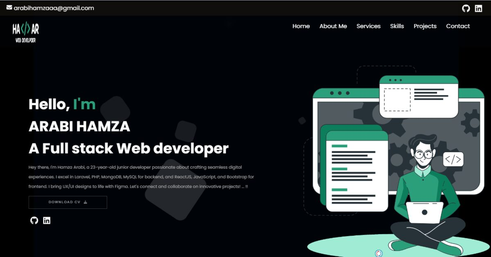

# Arabi Hamza — Portfolio v2

<p align="center">
  
</p>

Personal portfolio of **Arabi Hamza**, full-stack web developer based in morocco
(React · Laravel · PHP · MySQL · MongoDB), currently at Delta Holding, Rabat.

**Live site:** https://Hamzaarabi.github.io/portfolio/

## ✨ Highlights

- **Ground-up rebuild** — migrated from Create React App (deprecated) to **Vite 6 + React 19**
- **Custom design system** — Space Grotesk + Inter, emerald aurora gradients, glass cards
- **Dark / light themes** — persisted, respects `prefers-color-scheme`, no flash on load
- **⌘K command palette** — quick navigation, copy email, download CV, theme switch
- **Project case studies** — filter + search, WebP galleries with keyboard-accessible lightbox, prev/next navigation
- **Animated experience** — typewriter hero, counting stats, scroll-reveal sections, animated skill bars, marquee
- **Performance** — 68 images converted PNG → WebP (**~22 MB → 2.6 MB**), route-level code splitting, lazy images; total build ≈ 3.2 MB
- **SEO ready** — meta/OG/Twitter tags, JSON-LD `Person` schema, `sitemap.xml`, `robots.txt`, semantic HTML, per-page titles
- **Accessible** — skip link, ARIA labels, focus states, `prefers-reduced-motion` support, labelled form with validation
- **Working contact form** — EmailJS with validation, honeypot anti-spam and success/error feedback
- **Legacy-proof** — old v1 routes (`/AboutMe`, `/Projects`…) redirect to the new ones

## 🛠 Tech stack

| Area | Tools |
| --- | --- |
| Framework | React 19, React Router 7 |
| Build | Vite 6 |
| Styling | Hand-written CSS design system (no framework) |
| Icons | react-icons |
| Forms | EmailJS |
| Hosting | GitHub Pages (Actions) · Vercel-ready |

## 🚀 Quick start

```bash
npm install
npm run dev       # http://localhost:5173
```

| Script | What it does |
| --- | --- |
| `npm run dev` | Start the dev server (HMR) |
| `npm run build` | Production build → `dist/` |
| `npm run preview` | Preview the production build locally |
| `npm run deploy` | Build + publish to GitHub Pages via `gh-pages` |

## ✏️ Editing content

**All text lives in one file:** [`src/data/portfolio.js`](src/data/portfolio.js) —
profile, services, skills, experience, education, projects, FAQ.
Edit it and every page updates automatically. Drop new project screenshots
(WebP) into `src/assets/webp/projectN/` and they appear in the gallery in filename order.

- Replace the résumé by overwriting `public/Hamza-CV.pdf`
- Optional: copy `.env.example` → `.env` to use your own EmailJS keys

## 📦 Deployment

- **GitHub Pages** — every push to `main` builds in CI and publishes the result to the
  `gh-pages` branch via [`.github/workflows/deploy.yml`](.github/workflows/deploy.yml).
  Keep *Settings → Pages → Build and deployment* on **"Deploy from a branch: `gh-pages` / (root)"**.
  You can also publish manually anytime with `npm run deploy` (same destination).
- **Vercel** — import the repo; [`vercel.json`](vercel.json) already contains the
  build settings, SPA rewrites, security headers and immutable asset caching.

## 📁 Structure

```
src/
  data/portfolio.js     ← single source of truth for all content
  pages/                ← Home, About, Services, Skills, Projects(+Details), Contact, 404
  sections/             ← Hero, About, Services, Projects, Skills, Journey, Extras
  components/           ← Navbar, Footer, CommandPalette, Lightbox, ProjectCard…
  hooks/                ← typewriter, counters, theme, page titles
  styles/index.css      ← the whole design system
  assets/webp/          ← optimised project imagery
public/                 ← CV, favicon, OG image, manifest, robots, sitemap
```

## 📜 v1 → v2 changelog

Removed: Create React App, jQuery, Bootstrap CDN, react-slick, duplicated EmailJS package,
the 3-second fake loader, Hotjar, ~40 scattered CSS files and placeholder copy.
Fixed along the way: broken "next project" on the last case study, duplicated SEO bullets,
wrong WordPress description, stale copyright year, unlabelled form fields, and links that
broke under hash routing.
